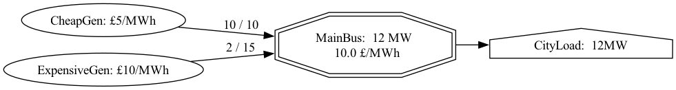

# microgrid
A tiny repo for simple electricity system modelling. Inspired by Andrej Karpathy's micrograd


## About:
A super lightweight libary for building simple energy balance models of electricity systems. Aimed to help quickly spin up models for first order type analyses.

*Design principles*
- Minimal dependencies
- Everything as native python objects
- Easy to inherit networks or subnetworks from other model files
- Networks drawn using graphviz
- Networks saved as json and duckdb files for further analysis

## Setup

Install dependencies using [uv](https://docs.astral.sh/uv/):

```bash
# Install uv if you haven't already
curl -LsSf https://astral.sh/uv/install.sh | sh

# Install dependencies
uv sync

# Run tests
uv run python -m unittest microgrid.test

```

## Usage

### Simple Network Example

Here's a basic example of creating and solving a simple electricity network:

```python
from microgrid.engine import Network, Bus, Generator, Load
from microgrid.save import save_network
from microgrid.draw import draw_network

# Create a network with two timesteps
timesteps = ['morning', 'evening']
network = Network("SimpleGrid", timesteps)

# Create a bus (electrical node)
bus = Bus("MainBus", network)

# Add generators with different costs
Generator("CheapGen", capacities=[10, 10], costs=[5, 5], bus=bus)
Generator("ExpensiveGen", capacities=[15, 15], costs=[10, 10], bus=bus)

# Add electrical load
Load("CityLoad", consumptions=[12, 8], bus=bus)

# Solve the optimization
status = network.solve()
print(f"Solution status: {status}")

# Check results
for gen_name, gen in bus.generators.items():
    print(f"{gen_name} outputs: {[out.varValue for out in gen.outputs]}")

print(f"Nodal prices: {bus.nodal_prices}")

# Save network
save_network(network, "simple_grid.json", "simple_grid.db")

# Draw network
dot = draw_network(network, "morning")
dot.render("simple_grid", format='png')
```
*Outputs*
- `simple_grid.png` - Network diagram for the morning timestep
- `simple_grid.db` - DuckDB database containing the model data
- `simple_grid.json` - JSON file containing the model data



This will find the optimal (lowest cost) dispatch of generators to meet the electrical load.

